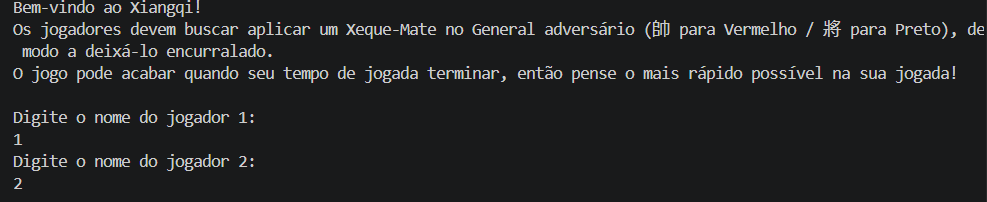
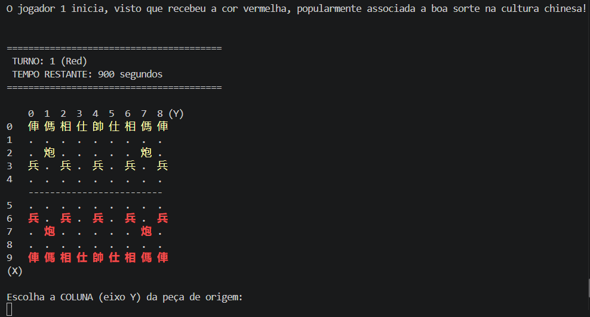
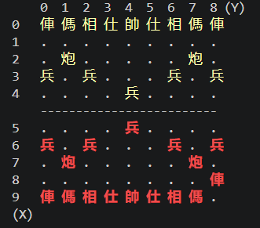
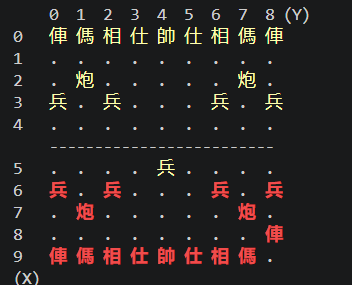
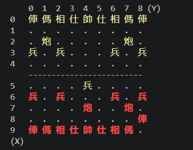

# board-game-engine-2026
Reutilizable engine in JAVA designed to run several different board games, from a JSON config file. It does not modify the engine's source code.
## First Checkpoint: Xiangqi
### How compile the project:
Run these PowerShell commands from the project root directory to compile:

```PowerShell
[Console]::OutputEncoding = [System.Text.UTF8Encoding]::new()
chcp 65001
New-Item -ItemType Directory -Force out | Out-Null
javac -encoding UTF-8 -sourcepath src -d out src/Main.java
```

If compilation finishes without errors, run the game:

```PowerShell
java '-Dfile.encoding=UTF-8' -cp out Main
```

Run the macOS commands from the project root directory:

```Mac
mkdir -p out
javac -encoding UTF-8 -sourcepath src -d out src/Main.java && java -Dfile.encoding=UTF-8 -cp out Main
```
### Images of game:
Start page


----
Initial Board


----
a captured piece



----
a check


----
a checkmate


