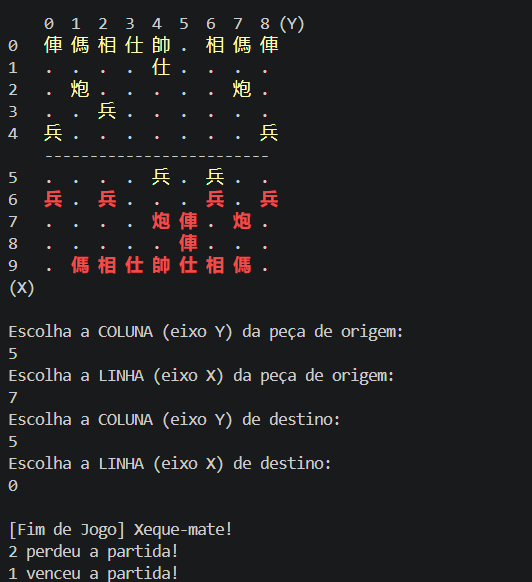

# board-game-engine-2026
Reutilizable engine in JAVA designed to run several different board games, from a JSON config file. It does not modify the engine's source code.

Obs: The class diagram is in the `docs` folder with a basic tutorial to play Xiangqi and a presentation.
## First Checkpoint: Xiangqi
### How compile the project:
Run these PowerShell commands from the project root directory to compile:

```PowerShell
[Console]::OutputEncoding = [System.Text.UTF8Encoding]::new()
chcp 65001
New-Item -ItemType Directory -Force out | Out-Null
javac -encoding UTF-8 -sourcepath src -d out src/Main.java
```

If compilation finishes without errors, run the game:

```PowerShell
java '-Dfile.encoding=UTF-8' -cp out Main
```

Run the macOS commands from the project root directory:

```Mac
mkdir -p out
javac -encoding UTF-8 -sourcepath src -d out src/Main.java && java -Dfile.encoding=UTF-8 -cp out Main
```
### Images of game:
Start page


----
Initial Board


----
a captured piece


----
a check


----
a checkmate



----
Para jogar: (portugues)
1. Insira o nome dos dois jogadores
2. O jogador vermelho começa a partida
3. O jogador insere a posicao da peca que quer jogar
4. O jogador insere a posicao desejada (se não souber como a peça se move tem um mini tutorial em /docs de como jogar)
5. Muda de turno e o jogador das peças preta jogará, alternando turno a turno, com um tempo limitado de jogo
6. Ganha quem fizer xeque-mate ou fazer o outro pensar demais e perder por tempo
7. O jogo pode ficar empatado se só houver peças defensivas em campo
